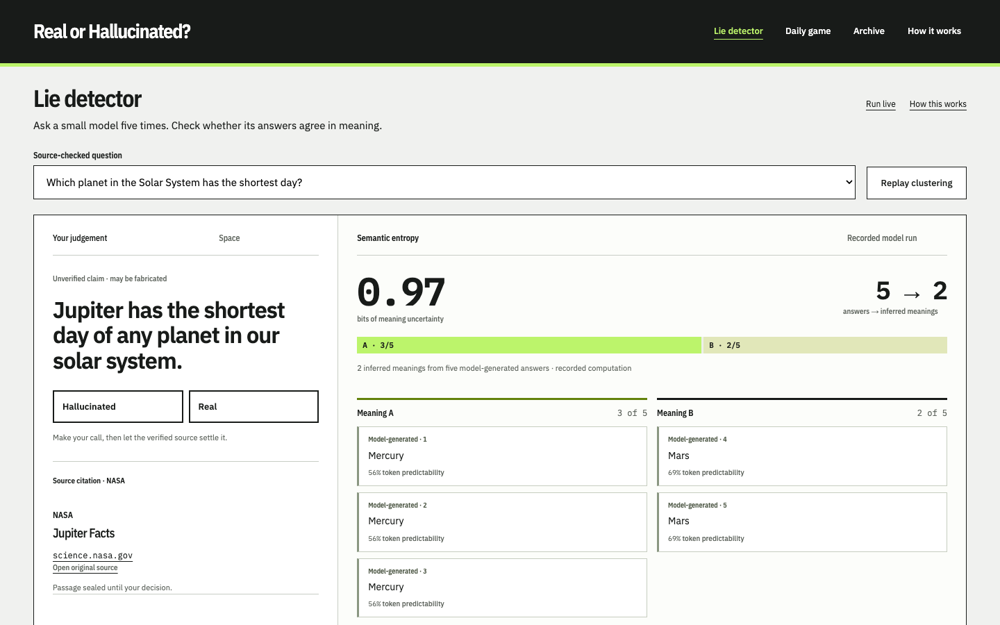

# Real or Hallucinated?
<!-- hf-badge -->

A fact-checking game and an inspectable browser experiment. Decide whether five cited claims are real or fabricated, then open the original evidence. The companion lie detector asks a small model the same question five times and shows whether its answers agree in meaning. The point is to make uncertainty and verification visible: a confident model never gets the final word over a checked source.

## Try it

Use Node.js 22.13 or later. Installing dependencies needs a network connection; the bundled game and recorded detector need no model download, API key or account.

```sh
npm ci
npm run dev
```

Open the local development server at **http://127.0.0.1:5177**. The first screen replays a real, clearly labelled model run. Click an answer to inspect its token probabilities, or choose **Inspect the links** to see both entailment directions. **Daily game** opens the five-claim round.

For optional live inference in a local preview, run this in a second terminal:

```sh
npm run models:fetch
```

This downloads **889.1 MB** of pinned Apache-2.0 model files from Hugging Face into the ignored `.cache/models/` directory. The downloader verifies sizes and SHA-256 digests and preserves at least 10 GiB free. Set `MODEL_DIR` consistently for the downloader and development server to reuse another model directory. It does not change the committed evaluation or model inventory.

Choose **Load models & run** on a desktop with WebGPU. Progress, cancel and cache removal are built in. Phones, Firefox and unsupported adapters keep the interactive recorded experience. Inference runs on-device; model-file downloads are not calls to a hosted inference API. A static build served outside loopback uses the pinned Hugging Face files after the same explicit opt-in.

To inspect a production build locally:

```sh
npm run build
npm run preview
```

The local production preview opens at **http://127.0.0.1:4184**. Original-source links require a connection when opened.

## How it works

The detector implements **discrete semantic entropy**, adapted from Farquhar, Kossen, Kuhn and Gal, [*Detecting hallucinations in large language models using semantic entropy*, Nature (2024)](https://www.nature.com/articles/s41586-024-07421-0):

1. Qwen2.5 0.5B Instruct samples five answers without seeing the source passage or reference answer.
2. DeBERTa xsmall NLI checks every answer pair in both directions. Complete-link grouping requires every pair in a group to entail both ways at probability 0.60 or above. This conservative grouping differs from the paper's representative-based implementation.
3. Each group's share of the five samples is its empirical probability, `p`. Entropy is `−Σ p log₂ p`: zero bits means one inferred meaning; about 2.32 bits means five.
4. Token colours show the generator's original softmax probabilities, before sampling adjustments. Predictability is separate from truth. A further NLI support index supplies the binary claim verdict; semantic entropy measures disagreement rather than deciding whether a claim is true.

The implementation uses a pinned Transformers.js browser SDK, WebGPU generation and single-threaded WASM entailment. WebKit isolates its CPU checker in a second worker. [Engine details](docs/ENGINE.md) describe the sampler, label order, cancellation and cache boundaries.

The daily game has fourteen editions and seventy claims. Every citation names a real public source. Fabrications alter a specific detail contradicted by that source; the reveal strikes out the invented phrase and corrects it in the margin. Real claims show an exact quote within its surrounding passage. Chemical notation is normalised for display only: stored quotes and verification matching stay unchanged.



## What it measures / proves

The recorded evaluation covers all **70 questions**, with five sampled answers each, in headless Chromium. It is bound to exact engine, runtime, model and answer digests. No source passage or reference answer entered generation.

| Recorded measure | Result |
|---|---:|
| Binary claim verdict accuracy | 42/70 · 60% |
| Claim-support AUROC | 0.6482 |
| Semantic-entropy AUROC for first-answer errors | 0.6335 |
| Token-confidence baseline AUROC | 0.6740 |
| First answer gives the requested fact | 20/70 · 28.6% |

**Semantic entropy did not beat token confidence on this set.** Answer labels check the requested fact, not every extra assertion; one ambiguous reply is conservatively counted as wrong. The page exposes every verdict. The [evaluation record](data/detector-recording.json) and [answer review](data/detector-review.json) retain the underlying evidence.

The automated browser suites exercise every claim and reveal: 245 daily assertions and 140 narrow-layout checks per engine, plus 48 detector assertions, in Chromium, WebKit and Firefox. The recorded typography measurement found total startup CLS and deliberately delayed font-swap CLS of **0** on both routes at 1440 × 900 and 390 × 844. Only Chromium exposed the native CLS API; the other engines passed geometry and fallback checks. [Measurement methods and dated results](docs/MEASUREMENTS.md) separate recorded scores, runtime controls and local rendering performance.

## Limits

- This is a small, related question set, with AI-assisted editorial labels rather than a blind independent human benchmark. It does not establish general hallucination-detection accuracy.
- Small models can confidently repeat a false answer, invent extra details or hit the 32-token cap. Five samples and a fallible entailment model only approximate meaning agreement.
- Claims, alterations and explanations were AI-authored. Source checks establish quote presence; interpreting the source still needs judgement. Fabrications exclude living people, company conduct, health advice and elections. Share text never repeats claims or answers.
- Fourteen editions repeat. Sources are dated snapshots, not continuously monitored facts. Physical-phone inference, native touch gestures and a full assistive-technology audit are not claimed.
- The full seventy-question recording used Chromium. WebKit live lifecycle checks covered the demo question, not a second benchmark. Recorded output remains useful when live inference is unavailable.

## How it was built

Designed, specified and reviewed by Harry Freeman; built with AI coding agents.

- Harry's first brief set the constraints: an original daily puzzle, checked primary sources, personal clean-room code, deliberate design and honest offline states.
- For V2, he chose a newsroom fact-check desk and asked for the anatomy of a fabrication: an exact redline, a margin correction and the source passage in context.
- For V3, he asked for on-device semantic entropy, visible answer clustering, token probabilities and published accuracy, including unflattering results.
- Review sent the evidence desk back for a sealed citation, display-only chemical notation and tighter composition. The later typography review standardised IBM Plex and required zero startup layout shift.

The [visual identity](IDENTITY.md) records those design choices. [Development notes](docs/DEVELOPMENT.md) explain the module boundaries and checks.

## Licence

Original code, interface and artwork: **MIT, Copyright (c) 2026 Harry Freeman**. See [LICENSE](LICENSE).

The vendored Transformers.js SDK and selected model weights are Apache-2.0; ONNX Runtime is MIT. Self-hosted IBM Plex fonts retain their SIL OFL 1.1 notices. The [dependency](docs/dependency-licenses.json), [model/runtime](docs/model-licenses.json) and [font](docs/font-licenses.json) inventories record versions, sources and licences.

Attributed source excerpts retain their publishers' rights and reuse terms. Sources include [NASA](https://science.nasa.gov/), [NOAA](https://oceanservice.noaa.gov/), [EIA](https://www.eia.gov/energyexplained/), [NPS](https://www.nps.gov/stli/learn/historyculture/statue-statistics.htm) and [NIST](https://www.nist.gov/si-redefinition/second). No agency logos, third-party photographs or endorsement are included.
